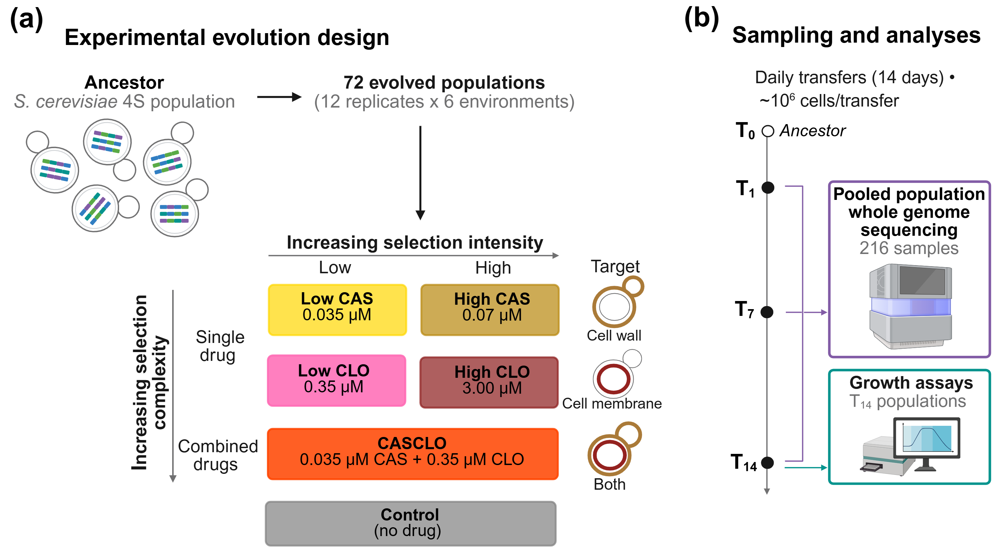

# Experimental-Evolution-Antifungal-Drug-Study

Analysis code and data for **Sandoval-Powers M, Crestani G, Dugo H, Shearman E, Burke MK.** *Adaptive responses to antifungal selection depend on dose and drug combination in experimentally evolved yeast*.

[](https://doi.org/PLACEHOLDER)
[](https://www.ncbi.nlm.nih.gov/bioproject/PRJNA1544638)

---

## Overview

Replicate populations founded from a genetically diverse, outcrossed **4S** *Saccharomyces cerevisiae* population were experimentally evolved under six selective regimes that varied in both the **intensity** and the **complexity** of antifungal selection.

Pooled whole-genome sequencing across three timepoints was used to track genome-wide allele frequency dynamics, and evolved populations were phenotyped for growth performance across drug environments.

This repository contains the scripts and small input/output files needed to reproduce the analyses and figures. Large files are archived on Figshare (see [Data availability](#data-availability)).

### Experimental design

<p align="center">
  
</p>

| | |
|---|---|
| Treatments | Low and high caspofungin (CAS), low and high clotrimazole (CLO), the two low concentrations combined (CASCLO), and a no-drug control |
| Populations | 12 replicates per treatment, 72 total, evolved for 14 days |
| Sampling | T1, T7, T14 → 216 pooled sequencing samples |
| SNPs | 64,764 biallelic sites after filtering |
| Coverage | median 86× (range 27×–290×) |

### Treatment naming

Sequencing files and NCBI records use the original scheme; the manuscript uses readable labels.

| Original | Manuscript |
|---|---|
| `EEA_CAP_S01_*` | Low CAS |
| `EEA_CAP_S03_*` | High CAS |
| `EEA_CLO_S01_*` | Low CLO |
| `EEA_CLO_S03_*` | High CLO |
| `EEA_CAC_S01_*` | CASCLO |
| `EEA_CTR_S01_*` | Control |

Timepoints `D01`, `D07` and `D14` correspond to T1, T7 and T14. The ancestor appears as `EEA_anc_4SH_12` and the four founders as `EEA_hap_*`.

> **A note on figures.** Figures are included alongside the scripts that generate them. Where a figure was assembled or annotated for publication, both versions are provided: the `.svg` written directly by the script, and the final `.png` after editing in Inkscape. Scripts reproduce the `.svg`, not the edited version.

---

## Repository structure

Each analysis folder has its own README with input and output tables.

```
Experimental-Evolution-Antifungal-Drugs/
├── Drug_Dose_Determination_Analysis/           # Dose–response assays used to set drug concentrations
├── Genomics_Analysis/
│   ├── SNP_QC_Workflow/                        # Coverage QC, filtering, PCA, SFS, early-fixed sites
│   ├── GLM_AF_Change_Workflow/                 # Quasibinomial GLMs of allele frequency over time
│   └── SNP_Analysis_and_Annotation_Workflow/   # Candidate classification, annotation, FungAMR, GO
├── Growth_Phenotyping_Analysis/                # Growth assays of evolved populations and ancestor
└── README.md
```

| Folder | Produces |
|---|---|
| [`Drug_Dose_Determination_Analysis/`](Drug_Dose_Determination_Analysis/) | Fig. S1 |
| [`Genomics_Analysis/`](Genomics_Analysis/) | Figs. 2–5, S2–S6 |
| [`Growth_Phenotyping_Analysis/`](Growth_Phenotyping_Analysis/) | Figs. 6, S7 |

---

## Reproducing the analysis

1. Clone this repository.
2. Download the Figshare deposit and place its folders into the corresponding directories here.
3. Run `Drug_Dose_Determination_Analysis/` and `Growth_Phenotyping_Analysis/` in any order; both are independent of the genomic workflow.
4. Run `Genomics_Analysis/` in order:
   `SNP_QC_Workflow/` → `GLM_AF_Change_Workflow/` → `SNP_Analysis_and_Annotation_Workflow/`

Before running:

- Write calls (`ggsave`, `write_tsv`, `write.xlsx`) are commented out by default. Uncomment to regenerate outputs.
- The GLM stage takes ~30 minutes. Its results tables are on Figshare if you want to skip refitting.
- Read alignment and variant calling are not reproducible from this repository. Start from the filtered SNP table on Figshare to reproduce downstream results.
- SnpEff runs outside this repository. The annotation script writes a VCF, SnpEff is run on it separately, and the annotated output is read back in.

---

## Data availability

| Resource | Location |
|---|---|
| Raw sequencing reads, evolved populations | NCBI SRA, [PRJNA1544638](https://www.ncbi.nlm.nih.gov/bioproject/PRJNA1544638) |
| Raw sequencing reads, 4S ancestor | NCBI SRA, [PRJNA678990](https://www.ncbi.nlm.nih.gov/bioproject/PRJNA678990) (Burke et al. 2020) |
| Large input and output files | Figshare, [`[DOI]`](https://doi.org/PLACEHOLDER) |
| Analysis code (this repository, archived) | Zenodo, [`[DOI]`](https://doi.org/PLACEHOLDER) |
| Manuscript | `[DOI]` |

Files too large for version control are archived on Figshare with **folder names and relative paths matching this repository**. Download the deposit and place the folders into your clone; scripts will resolve their paths without editing.

---

## Requirements

**R** ≥ 4.5.1

```r
# CRAN
install.packages(c(
  "tidyverse",      # ggplot2, dplyr, tidyr, stringr, readr, purrr, tibble
  "data.table", "reshape2", "glue", "scales",
  "cowplot", "patchwork", "ggh4x", "ggridges", "ghibli", "ggpattern",
  "ComplexUpset", "gggenes",
  "factoextra", "svglite", "ggrastr",
  "lme4", "lmerTest", "emmeans", "multcompView", "growthcurver",
  "pbapply", "openxlsx"
))

# Bioconductor
if (!require("BiocManager")) install.packages("BiocManager")
BiocManager::install(c("topGO", "org.Sc.sgd.db", "rrvgo", "Rgraphviz", "rtracklayer"))
```

Several Bioconductor packages mask `dplyr` verbs. The scripts alias `select`, `filter` and `rename` to the `dplyr` versions after loading.

---

## Citation

```
[Full citation once published]
```

---

## Contact

**Megan Sandoval-Powers** — sandovme@oregonstate.edu

Department of Integrative Biology, Oregon State University, Corvallis, OR 97331, USA
